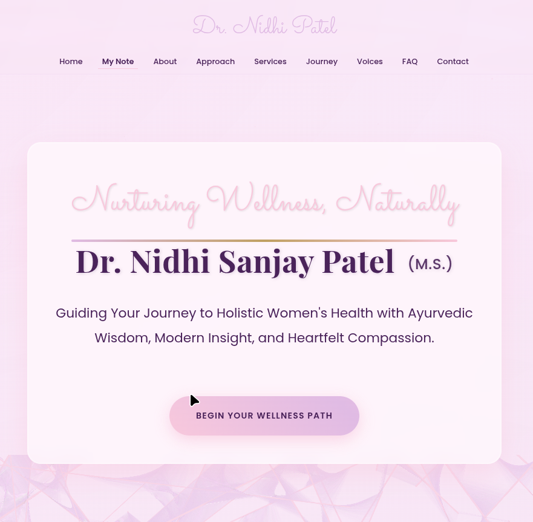

# DrNidhi_portfolio

Personal website and academic publication record of **Dr. Nidhi Sanjay Patel** (B.A.M.S., M.S. Ayurveda —
Prasuti Tantra & Stree Roga), Assistant Professor at Uka Tarsadia University (UTU), Bardoli, Gujarat.

Live site: **https://www.drnidhi.net/**



---

## What is in this repository

| Path | What it is |
|---|---|
| `index.html` | The single-page website. Also carries the `Person` JSON-LD and the Publications preview block. |
| `style.css` | Site styles (plus the `#publications` block styles). |
| `script.js` | Navigation, scroll-reveal, compass widget, dinacharya tabs, FAQ. |
| `writing/` | The full publication library — see below. |
| `sitemap.xml` | XML sitemap, 22 URLs. |
| `robots.txt` | Allows search engines, AI answer engines and academic crawlers. |
| `rss.xml` | RSS feed of the publication record. |
| `newdata/` | **Source material** (7.2 GB of original documents). *Not committed* — it is the working archive the publications were built from. |

---

## The Publications library

`writing/` is a complete, self-contained open-access publication site. Every work authored
or presented by Dr. Nidhi Patel is published there in full, with metadata, citations and a
downloadable PDF.

```
writing/
├── index.html            Landing page — searchable, filterable catalogue
├── library.json          Machine-readable catalogue of all 20 works
├── <slug>.html           One page per work (20 pages)
├── assets/
│   ├── pub.css           Styles for the publications pages
│   └── pub.js            Search + type filter
├── files/
│   ├── <slug>.pdf        Open-access PDF: title page + abstract + full text + citations
│   └── <slug>-source.*   The original document as submitted
├── print/                Print templates used to generate the PDFs
├── upload-kit/           Ready-to-paste metadata for every external platform
├── catalog.py            The single source of truth for the catalogue
├── build.py              Generates the pages, PDFs, sitemap, robots, RSS
├── build_kit.py          Generates the upload kit
├── extractor.py          DOCX/PPTX/PDF text extraction
└── verify.py             Validation — run this after any change
```

### The catalogue

20 works, all authored or presented by Dr. Nidhi Patel:

| Type | Count | Works |
|---|---|---|
| M.S. dissertation | 1 | Lashuna Kalpa & Rasnadi Taila Uttar Basti in Artava Kshaya — a randomised clinical study in 30 subjects |
| Peer-reviewed article | 2 | Effect of Pumsavana Karma in Conception (IJCRT); Role of Dinacharya in the Prevention of Health Hazards of Pollution |
| Conference abstracts | 4 | Panchakarma in Vandhyatwa; Preconceptional Care; Role of Uttarbasti in Yonivyapada; Ayurveda for Public Health |
| Seminar presentations | 13 | Pathya, Rasa, Sadarasa, Vomiting in Pregnancy, Stages of Labour, Epilepsy in Pregnancy, GDM, Artava Kshaya, Delivery of IUGR, Abnormal Development of Fallopian Tube and Ovary, Applied Anatomy of the Abdomen, Prasava Vigyana, Dinacharya & Immunity |

Material belonging to other doctors and colleagues is deliberately excluded, as are all patient
records, admission letters, score cards and other personal documents.

### Rebuilding

```bash
py writing/build.py       # pages, PDFs, sitemap.xml, robots.txt, rss.xml, index.html patch
py writing/build_kit.py   # upload-kit/ (CSV per platform + guides)
py writing/verify.py      # validation — should report 0 errors
```

Requires Python 3, `pypdf` (`py -m pip install pypdf`) and Google Chrome (for PDF rendering).

### Upload kit

`writing/upload-kit/` contains everything needed to publish the same work on other
platforms, with the exact title, abstract, keywords, description and citation for each:

| File | What it gives you |
|---|---|
| `MASTER-UPLOAD-PLAN.md` | **Start here.** Every platform with its live signup/upload link, ranked by impact, plus the patient-facing track, the mistakes to avoid and a 14-day sprint |
| `upload-console.html` | Open in a browser: every field with a copy button, one tab per platform, progress saved locally |
| `TRACKER.csv` | 105 individual upload actions with status, public URL and DOI columns |
| `PROFILE-COPY.md` | Bios at every character limit, service descriptions, FAQ, review-request scripts, social bios, post ideas |
| `zenodo_deposit.py` | Bulk deposit to Zenodo and mint DOIs (`--dry-run` first, `--publish` to mint) |
| `osf_deposit.py` | Create an OSF project and upload all 20 PDFs (`--publish` to make it public) |
| `GOOGLE-BUSINESS-PROFILE.md` | The patient-acquisition setup: claiming/creating the listing, copy-paste fields, photos, verification, review script |
| `UPLOAD-GUIDE.md` | Step-by-step instructions for each academic platform, in the right order |
| `ORDER-RECOMMENDATION.md` | Which work to upload first, and which audience each platform reaches |
| `HOOKS.md` | The hook strategy — content hooks, technical hooks, citation hooks, link hooks, and how to measure them |
| `MANIFEST.json` | Every work, every platform field, machine-readable |
| `researchgate.csv` `academia.csv` `academia_india.csv` `scribd.csv` `slideshare.csv` `zenodo.csv` `osf.csv` `scholar.csv` `doaj.csv` | One row per work, ready to paste |

Fill in the `Public URL (after upload)` column as you go, so the kit stays auditable.

Regenerate the console and tracker after any catalogue change:

```bash
py writing/build_console.py
```

---

## SEO / discovery hooks

- `ScholarlyArticle` + `citation_*` JSON-LD on every work page
- `BreadcrumbList` on every work page, `ItemList` on the index, `Person` with `hasPublished` on the home page
- Canonical URLs, Open Graph and Twitter card tags on every page
- `sitemap.xml` (22 URLs), `robots.txt` explicitly allowing scholarly and AI crawlers, `rss.xml`
- APA / Vancouver / BibTeX citation blocks on every work page
- Internal topic clusters linking the works to each other; keywords link back into the filtered index
- `library.json` for any tool that wants to ingest the whole record

---

## Stack

Vanilla HTML, CSS and JavaScript. No build step for the site itself — `writing/build.py` is a
one-off content pipeline, not a bundler.
